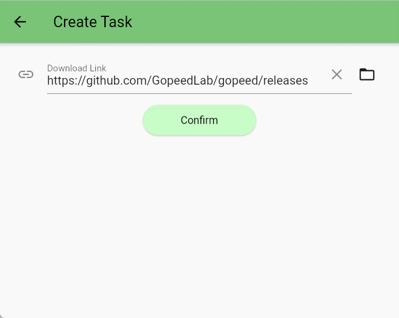

[English](README.md) | [中文](README_zh-CN.md)

## Introduction

This extension registers the `onResolve` event to parse all resource information from a `github release` download link and display it in the file list for selection.

## Settings

- **User-Agent**: HTTP User-Agent header used for GitHub API requests.
- **GitHub API Token** (optional): In Gopeed's extension settings, enter a [GitHub personal access token](https://docs.github.com/en/authentication/keeping-your-account-and-data-secure/managing-your-personal-access-tokens) to use the [higher authenticated API rate limit](https://docs.github.com/en/rest/using-the-rest-api/rate-limits-for-the-rest-api). Leave it empty to make anonymous requests. Authenticated requests are still subject to rate limits.

The token is sent only to the GitHub API in the `Authorization: Bearer` header when resolving releases; it is not added to asset download requests.

Supported links: `https://github.com/<owner>/<repo>/releases`, `/releases/latest`, and `/releases/tag/<tag>`.

## Implementation

The extension is written in pure JavaScript and uses `fetch` to request the corresponding `release` information from the GitHub API, and then parses all resource information and returns it to the downloader.

- Screenshot

